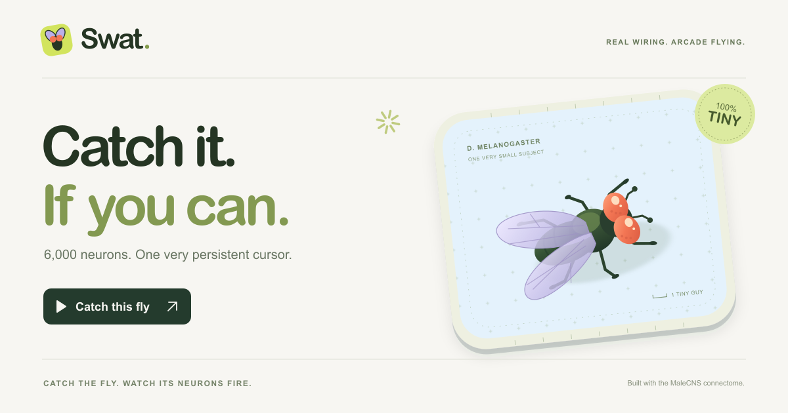

# Swat.

Catch it. If you can.



A browser arcade game with a tiny airborne fly, an oversized swatter, and a live view of the neural circuit behind its escape reflex. Move the swatter closer and watch **Tiny mind** light up before you even click.

[Play Swat](https://fruitfly-tiny-brain.vercel.app/) · [How it works](docs/architecture.md) · [Neural model](src/neural/README.md) · [Contributing](CONTRIBUTING.md)

## Real wiring. Arcade flying.

Swat runs a simplified spiking model of **6,000 traced fruit-fly neurons and 1,275,994 directed connections** from the MaleCNS v1.0 connectome. The connections preserve 10,659,685 original synaptic contacts. These are different counts: several contacts can connect the same pair of neurons.

Simulated vision feeds an extracted LC16-to-MDN retreat circuit. Its activity influences evasive turns and bursts; the brain viewer displays the model's actual recent activity. Baseline cruising, flight animation and collision rules are authored game mechanics.

This is a playful adaptation of a real circuit, **not a whole-brain emulation, a validated flight controller, or a trained AI**. The game uses one fixed, fully enabled circuit. Smaller graphs and neuron-silencing interventions are retained for offline tests, not player difficulty controls.

## Run locally

Use Node.js 24 and npm. No API keys, account, database or inference server are needed.

```sh
git clone https://github.com/hrook1/Swat.git
cd Swat
npm ci
npm run dev
```

Open the local address printed by the development server. The prepared circuit files are included; a normal build does not download the raw connectome or require Python.

```sh
npm run verify   # Types, lint, formatting, secret checks, tests and build
npm run preview  # Serve the production build locally
```

## Play and record

Read the welcome screen, click **Let's go**, then start a 30-second round. Aim ahead: the swatter lands **240 ms after your click**, at the position you committed to. Another swing becomes available 560 ms after the previous click.

| Input     | Action                                                  |
| --------- | ------------------------------------------------------- |
| Mouse     | Move to aim; click to swat                              |
| Touch     | Drag to aim; tap **SWAT**                               |
| Keyboard  | Arrow keys aim; Space starts or swats; R resets         |
| Tiny mind | Drag to rotate; select a neuron to inspect its identity |
| `?`       | Reopen the instructions                                 |

Reset returns to the original seed; Rematch generates a new route. A `?seed=34` URL fixes the starting seed for a reproducible setup, not a replay of someone else's pointer movements.

**Record clip** captures the game and neural view together, silently, at up to 30 fps. Stop manually or let it finish after 30 seconds. The browser chooses supported MP4 or WebM output; a PNG snapshot is the fallback. After a round, **Slow-mo replay** shows the last swat—or recent gameplay if no swat was taken—at 0.4× using recorded pose and activity snapshots.

## Project layout

| Path              | Responsibility                                                |
| ----------------- | ------------------------------------------------------------- |
| `src/App.tsx`     | Interface, input, welcome/help, replay and capture            |
| `src/components/` | Welcome, help and model-information dialogs                   |
| `src/game/`       | Game rules, sensory adapter, worker and fixed-step scheduling |
| `src/neural/`     | Sparse point-neuron simulation and model documentation        |
| `src/render/`     | Three.js scenes, activity visualization and impact effects    |
| `src/shared/`     | Typed contracts and modal policy                              |
| `src/theme/`      | Shared colour tokens                                          |
| `public/data/`    | Prepared circuits, manifests, calibration and attribution     |
| `scripts/`        | Data extraction, model probes and release checks              |
| `docs/`           | Maintained architecture and contributor references            |

Tests sit beside the behaviour they protect. React and Three.js handle presentation; a dedicated Web Worker owns neural integration and game state. The production output is a static Vite build that can be hosted on Vercel without a backend.

## Verification and limitations

The automated suite checks deterministic simulation, numerical reference cases, graph integrity, input/output interventions, worker recovery, swat timing, hitbox projection, replay presentation and UI contracts. An optional longer-running check is available:

```sh
RUN_GAME_SOAK=1 npm run test:unit -- src/game/Game.soak.test.ts
```

These are software and model regression tests, not biological validation or a guarantee of performance on every device. The large graph costs memory and CPU; the UI reports when simulation speed falls behind. A recent browser with WebGL and hardware acceleration is recommended. Video export support varies by browser. See the [architecture notes](docs/architecture.md) for runtime boundaries and a release checklist.

## Data and scientific credits

The adapted **MaleCNS v1.0** data comes from FlyEM / HHMI Janelia Research Campus, the University of Cambridge, the MRC Laboratory of Molecular Biology and Google Research. It is provided under [CC BY 4.0](https://creativecommons.org/licenses/by/4.0/). Selection rules, source checksums, anatomical omissions and modelling assumptions accompany each prepared graph.

- [MaleCNS data and downloads](https://male-cns.janelia.org/download/)
- [Data attribution and adaptations](public/data/ATTRIBUTION.md)
- [Model details and data reproduction](src/neural/README.md)
- [Sen et al.: visually evoked retreat](https://pubmed.ncbi.nlm.nih.gov/28238656/)
- [Shiu et al.: connectome-based point-neuron modelling](https://pmc.ncbi.nlm.nih.gov/articles/PMC11446845/)

The upstream researchers have not endorsed this game. Their data license is separate from any license applying to the application code or other assets.
